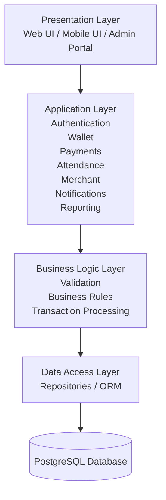
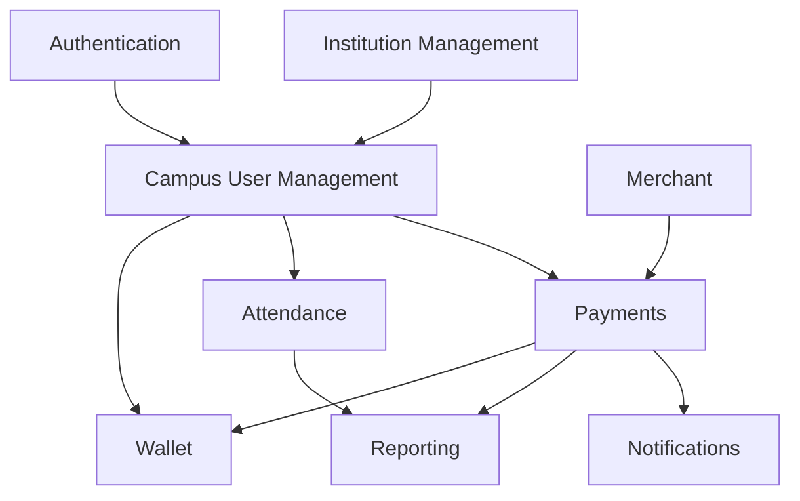

# CampusPay Software Architecture

**Document ID:** CP-ARCH-001  
**Version:** 1.0  
**Status:** Approved  
**Owner:** CampusPay Engineering Team  
**Project:** CampusPay – Campus Financial Operating System  
**Last Updated:** 27 July 2026

---

# 1. Introduction

## 1.1 Purpose

This document defines the high-level software architecture of CampusPay.

It describes the organisation of the software system, its major architectural components, architectural principles, module boundaries, interactions, and governance.

The purpose of this document is to provide the architectural blueprint from which software implementation, database design, APIs, deployment, and testing are derived.

This document answers the engineering question:

> **How is CampusPay organised to satisfy the Software Requirements Specification (SRS)?**

---

## 1.2 Scope

This document defines:

- Overall software architecture
- Architectural style
- Logical architecture
- Module architecture
- Cross-cutting concerns
- Multi-tenant architecture
- Security architecture
- Integration architecture
- Deployment architecture
- Observability
- Quality attributes
- Architectural governance

The following are intentionally outside the scope of this document:

- Database schema
- REST API specifications
- User Interface design
- Source code
- Framework-specific implementation
- Infrastructure configuration

These are documented separately.

---

## 1.3 Intended Audience

This document is intended for:

- Software Architects
- Software Engineers
- Technical Leads
- QA Engineers
- DevOps Engineers
- Security Engineers
- Product Owners

---

## 1.4 Architectural Philosophy

CampusPay follows a documentation-first engineering approach.

The architecture is governed by the following principles:

- Business requirements drive architecture.
- Architecture drives implementation.
- Simplicity is preferred over unnecessary complexity.
- Modules own their business domains.
- Changes to architecture require documented architectural decisions (ADRs).

---

## 1.5 Related Documents

This document should be read together with:

- PROJECT_VISION.md
- BUSINESS_MODEL.md
- PRODUCT_REQUIREMENTS.md
- SRS.md
- DATABASE.md
- API.md
- SECURITY.md
- DEPLOYMENT.md

Governed by:

- ADR-0001 — Multi-Tenant SaaS
- ADR-0002 — Modular Monolith

---

# 2. Architectural Goals

The CampusPay architecture is designed to achieve the following objectives.

## Scalability

Support growth in:

- Institutions
- Users
- Devices
- Transactions

without requiring architectural redesign.

---

## Maintainability

Organise software into independent modules with clearly defined responsibilities.

---

## Security

Protect institutional data through authentication, authorisation, encryption, tenant isolation, and auditing.

---

## Reliability

Maintain business consistency during recoverable failures.

---

## Availability

Support deployment strategies that minimise downtime and simplify maintenance.

---

## Extensibility

Allow new business capabilities to be introduced with minimal impact on existing modules.

---

## Testability

Ensure business logic can be tested independently from infrastructure.

---

## Configurability

Support institution-specific behaviour through configuration rather than code modifications.

---

## Auditability

Ensure business-critical operations produce immutable audit records.

---

# 3. Architectural Principles

CampusPay follows the following architectural principles.

## 3.1 Modular Monolith

The software is implemented as a modular monolith with clearly defined business modules.

---

## 3.2 Multi-Tenant SaaS

The platform supports multiple educational institutions while maintaining complete tenant isolation.

---

## 3.3 Domain-Oriented Modules

Modules are organised around business capabilities rather than technical layers.

---

## 3.4 Separation of Concerns

Each layer and module has a single primary responsibility.

---

## 3.5 High Cohesion

Related business logic remains within the same module.

---

## 3.6 Low Coupling

Modules communicate only through published interfaces.

---

## 3.7 API First

Business capabilities are exposed through stable APIs.

---

## 3.8 Security by Design

Security is incorporated into every architectural layer rather than added later.

---

## 3.9 Audit by Default

Business-critical actions are automatically auditable.

---

## 3.10 Configuration over Customisation

Institution-specific behaviour is driven by configuration.

---

## 3.11 Simplicity by Default

The architecture intentionally avoids unnecessary complexity.

---

# 4. Architectural Style

## 4.1 Selected Style

CampusPay adopts a **Modular Monolith** architecture.

This architectural decision is defined by ADR-0002.

---

## 4.2 Architectural Characteristics

The architecture exhibits the following characteristics.

- Single deployable application
- Independent business modules
- Shared runtime
- Shared infrastructure
- Shared database
- Strong module boundaries
- API-first communication
- Multi-tenant awareness

---

## 4.3 Why Modular Monolith

The Modular Monolith architecture was selected because it:

- reduces operational complexity,
- simplifies deployment,
- maintains transactional consistency,
- supports rapid product evolution,
- improves maintainability,
- enables straightforward testing,
- supports future migration to distributed services when justified.

Microservices are intentionally deferred until measurable operational or business requirements justify the additional complexity.

---

## 4.4 Future Evolution

The architecture is intentionally designed so that modules may later evolve into independently deployable services without requiring major domain redesign.

Potential candidates include:

- Payments
- Notifications
- Reporting

Service extraction shall occur only when supported by measurable engineering or business evidence.

---

# 5. System Context

CampusPay operates as the central financial operating platform for educational institutions.

The platform interacts with the following external actors and systems.

## Human Actors

- Students
- Faculty Members
- Finance Officers
- Institution Administrators
- Platform Administrators
- Merchants
- Support Personnel

---

## External Systems

- Payment Gateways
- Email Providers
- SMS Providers
- Push Notification Providers
- Identity Providers
- Device Management Systems

---

## Primary Responsibilities

CampusPay coordinates:

- Identity
- Wallets
- Payments
- Attendance
- Notifications
- Reporting
- Institution Management
- Device Management

---

# 6. Logical Architecture

CampusPay is organised into four logical layers.

---

## 6.1 Presentation Layer

Responsibilities:

- User Interface
- Request Handling
- Input Validation
- Authentication Entry Points

The Presentation Layer contains no business logic.

---

## 6.2 Application Layer

Responsibilities:

- Application Services
- Workflow Coordination
- Transaction Management
- Authorisation
- Use Case Execution

This layer coordinates business operations but does not own business rules.

---

## 6.3 Domain Layer

Responsibilities:

- Business Rules
- Domain Models
- Domain Services
- Business Validation

The Domain Layer represents the core of the CampusPay platform.

Business rules shall reside exclusively within this layer.

---

## 6.4 Infrastructure Layer

Responsibilities:

- Database Access
- External Integrations
- Messaging
- File Storage
- Identity Providers
- Logging
- Monitoring

Infrastructure provides technical capabilities without owning business behaviour.

---

# 7. Module Architecture

## 7.1 Overview

CampusPay is organised into independent business modules.

Each module represents a distinct business capability and is responsible for managing its own business rules, entities, validations, and services.

The architecture follows the principles of:

- High Cohesion
- Low Coupling
- Single Responsibility
- Explicit Dependencies
- Domain Ownership

Modules communicate only through published interfaces and shall never access another module's internal implementation or persistence layer.

The core modules are:

1. Authentication
2. Institution
3. Campus User
4. Wallet
5. Payments
6. Merchant
7. Attendance
8. Notifications
9. Reporting
10. Device

---

# 7.2 Authentication Module

## Purpose

Provides secure authentication and session management for all CampusPay users.

## Responsibilities

- User Authentication
- Password Management
- Session Management
- Token Generation
- Password Reset
- Account Locking
- Multi-Factor Authentication (Future)
- Authentication Audit Logging

## Public Interfaces

- Login
- Logout
- Refresh Session
- Validate Session
- Change Password
- Reset Password

## Depends On

- Campus User

## Owned Business Entities

- Credential
- Session
- Authentication Token
- Password Reset Request

## Notes

This module authenticates users only.

User information remains owned by the Campus User module.

---

# 7.3 Institution Module

## Purpose

Represents educational institutions (tenants) using the CampusPay platform.

## Responsibilities

- Institution Registration
- Institution Configuration
- Academic Settings
- Financial Settings
- Tenant Lifecycle
- Tenant Activation
- Tenant Suspension

## Public Interfaces

- Create Institution
- Update Institution
- Configure Institution
- Activate Institution
- Suspend Institution

## Depends On

None

## Owned Business Entities

- Institution
- Institution Configuration
- Academic Configuration
- Financial Configuration

## Notes

The Institution module is the root of tenant ownership.

Every business record belongs to exactly one Institution.

---

# 7.4 Campus User Module

## Purpose

Manages all users belonging to an institution.

## Responsibilities

- User Registration
- User Profiles
- User Roles
- Permissions
- Department Assignment
- Student Records
- Faculty Records
- Administrative Users

## Public Interfaces

- Create User
- Update User
- Disable User
- Assign Role
- Assign Permission

## Depends On

- Institution

## Owned Business Entities

- Campus User
- Student
- Faculty
- Administrator
- Role
- Permission

## Notes

Authentication information is intentionally excluded.

Credentials belong to the Authentication module.

---

# 7.5 Wallet Module

## Purpose

Provides digital wallet functionality for CampusPay users.

## Responsibilities

- Wallet Creation
- Wallet Balance
- Wallet Recharge
- Wallet Debit
- Wallet Credit
- Balance Validation
- Wallet Transaction History

## Public Interfaces

- Create Wallet
- Recharge Wallet
- Debit Wallet
- Credit Wallet
- Get Balance
- Wallet History

## Depends On

- Campus User
- Institution

## Owned Business Entities

- Wallet
- Wallet Balance
- Wallet Transaction

## Notes

Wallet balances are managed exclusively by this module.

Other modules must never modify wallet balances directly.

---

# 7.6 Payments Module

## Purpose

Processes financial transactions within CampusPay.

## Responsibilities

- Payment Processing
- Fee Payments
- Merchant Payments
- Refund Processing
- Payment Validation
- Transaction Recording
- Payment Status Tracking

## Public Interfaces

- Initiate Payment
- Complete Payment
- Cancel Payment
- Refund Payment
- Payment Status

## Depends On

- Wallet
- Merchant

## Owned Business Entities

- Payment
- Payment Transaction
- Refund

## Notes

This module coordinates payment workflows.

Wallet operations remain delegated to the Wallet module.

---

# 7.7 Merchant Module

## Purpose

Manages merchants authorised to receive CampusPay payments.

## Responsibilities

- Merchant Registration
- Merchant Categories
- Merchant Approval
- Merchant Configuration
- Merchant Status

## Public Interfaces

- Register Merchant
- Update Merchant
- Suspend Merchant
- Merchant Details

## Depends On

- Institution

## Owned Business Entities

- Merchant
- Merchant Category

## Notes

Merchant financial transactions are owned by the Payments module.

---

# 7.8 Attendance Module

## Purpose

Records and manages institutional attendance information.

## Responsibilities

- Attendance Recording
- Attendance Verification
- Attendance History
- Attendance Reports
- Attendance Corrections
- Attendance Analytics

## Public Interfaces

- Record Attendance
- Update Attendance
- Attendance History
- Attendance Summary

## Depends On

- Campus User

## Owned Business Entities

- Attendance Record
- Attendance Session
- Attendance Status

## Notes

Attendance may be integrated with biometric devices in future releases.

---

# 7.9 Notifications Module

## Purpose

Delivers notifications to CampusPay users.

## Responsibilities

- Email Notifications
- SMS Notifications
- Push Notifications
- Notification Templates
- Delivery Tracking
- User Preferences

## Public Interfaces

- Send Notification
- Schedule Notification
- Notification Status
- Manage Templates

## Depends On

- Campus User

## Owned Business Entities

- Notification
- Notification Template
- Delivery Record
- Notification Preference

## Notes

Actual delivery providers are implemented within the Infrastructure Layer.

---

# 7.10 Reporting Module

## Purpose

Provides operational and financial reporting.

## Responsibilities

- Financial Reports
- Attendance Reports
- Merchant Reports
- Wallet Reports
- Institution Dashboards
- Operational Analytics

## Public Interfaces

- Generate Report
- Export Report
- Dashboard Summary

## Depends On

- Wallet
- Payments
- Attendance
- Merchant

## Owned Business Entities

- Report Definition
- Generated Report
- Dashboard Metric

## Notes

Reporting consumes information from other modules but does not own their business entities.

---

# 7.11 Device Module

## Purpose

Manages physical devices connected to CampusPay.

## Responsibilities

- Device Registration
- Device Configuration
- Device Health Monitoring
- Device Assignment
- Device Status

## Public Interfaces

- Register Device
- Update Device
- Device Health
- Device Configuration

## Depends On

- Institution

## Owned Business Entities

- Device
- Device Configuration
- Device Status

## Notes

Future devices may include:

- QR Scanners
- NFC Readers
- Face Recognition Systems
- Biometric Devices
- Smart Kiosks

---

# 7.12 Module Ownership Principles

The following principles apply to every module.

1. Every business entity has exactly one owning module.

2. Business rules shall reside within the owning module.

3. Modules communicate only through published interfaces.

4. Modules shall never directly access another module's persistence layer.

5. Cyclic dependencies are prohibited.

6. Cross-cutting concerns are implemented centrally.

7. Tenant isolation shall never be bypassed.

8. Shared infrastructure shall not contain business logic.

9. Future modules shall follow the same architectural conventions.

10. Architectural changes require a new Architectural Decision Record (ADR).

---

# 8. Module Dependency Rules

## 8.1 Purpose

The Module Dependency Rules define how modules interact within the CampusPay architecture.

These rules ensure that modules remain loosely coupled, maintainable, and independently evolvable while preserving overall system consistency.

All software components shall comply with these rules unless an Architectural Decision Record (ADR) explicitly states otherwise.

---

## 8.2 Architectural Rules

### Rule 1 — Module Ownership

Every business entity shall have exactly one owning module.

No entity shall be owned by multiple modules.

---

### Rule 2 — Business Rule Ownership

Business rules shall reside exclusively within the module that owns the associated business entities.

---

### Rule 3 — Published Interfaces

Modules shall communicate only through published interfaces.

Internal implementation details shall remain private to the owning module.

---

### Rule 4 — Persistence Isolation

A module shall never directly access another module's database tables, repositories, or persistence mechanisms.

---

### Rule 5 — No Cyclic Dependencies

Dependencies between modules shall always form an acyclic graph.

Circular dependencies are prohibited.

---

### Rule 6 — Shared Infrastructure

Infrastructure components shall provide technical capabilities only.

Infrastructure shall never contain business rules.

Examples include:

- Database Access
- Logging
- File Storage
- Email Delivery
- SMS Delivery
- External API Clients

---

### Rule 7 — Tenant Isolation

Every module shall enforce tenant isolation.

Business operations shall never expose another tenant's data.

---

### Rule 8 — Explicit Dependencies

Module dependencies shall be clearly defined.

Hidden dependencies are prohibited.

---

### Rule 9 — Stable Interfaces

Public interfaces should remain stable.

Breaking interface changes shall require architectural review.

---

### Rule 10 — Architectural Governance

Changes affecting module responsibilities or dependencies require an approved Architectural Decision Record (ADR).

---

## 8.3 Module Dependency Matrix

| Module | Depends On |
|---------|------------|
| Authentication | Campus User |
| Institution | None |
| Campus User | Institution |
| Wallet | Campus User, Institution |
| Payments | Wallet, Merchant |
| Merchant | Institution |
| Attendance | Campus User |
| Notifications | Campus User |
| Reporting | Wallet, Payments, Attendance, Merchant |
| Device | Institution |

---

## 8.4 Dependency Direction

Dependencies shall always flow toward business ownership.

Example:

Institution
↓
Campus User
↓
Wallet
↓
Payments

Reverse dependencies are prohibited.

---

## 8.5 Module Communication Principles

Modules communicate through well-defined application services.

Direct communication through:

- database queries,
- repository access,
- internal objects,

is prohibited.

---

# 9. Cross-Cutting Concerns

## 9.1 Overview

Cross-cutting concerns are architectural capabilities shared across all modules.

They provide common functionality without introducing business responsibilities.

---

## 9.2 Authentication

Authentication verifies user identity before allowing access to protected resources.

Authentication responsibilities include:

- Login
- Logout
- Session Validation
- Token Validation
- Password Management

---

## 9.3 Authorisation

Authorisation determines whether an authenticated user may perform a requested action.

CampusPay adopts Role-Based Access Control (RBAC).

Permissions are assigned through roles.

---

## 9.4 Logging

All significant application events shall be recorded using structured logging.

Logging shall support:

- Diagnostics
- Monitoring
- Incident Investigation

Sensitive information shall never be logged.

---

## 9.5 Auditing

Business-critical operations shall generate immutable audit records.

Examples include:

- Authentication
- Payments
- Wallet Operations
- Role Changes
- Institution Configuration

---

## 9.6 Validation

Input validation shall occur before business processing.

Business validation shall occur within the owning domain module.

---

## 9.7 Exception Handling

Exceptions shall be handled consistently across the platform.

Internal implementation details shall never be exposed to end users.

---

## 9.8 Configuration Management

Application behaviour shall be driven through configuration wherever practical.

Configuration includes:

- Institution Settings
- Payment Settings
- Notification Settings
- Security Policies

---

## 9.9 Tenant Resolution

Every request shall resolve the active tenant before business processing begins.

Tenant resolution shall occur automatically and consistently across all modules.

---

## 9.10 Monitoring

The platform shall expose operational metrics for monitoring system health.

Monitoring supports:

- Availability
- Performance
- Capacity Planning
- Incident Response

---

# 10. Multi-Tenant Architecture

## 10.1 Overview

CampusPay is designed as a commercial multi-tenant Software-as-a-Service (SaaS) platform.

Each educational institution operates as an independent tenant.

---

## 10.2 Tenant Isolation

Every tenant maintains complete logical separation of:

- Users
- Wallets
- Payments
- Attendance
- Devices
- Reports
- Configuration

Data belonging to one tenant shall never be visible to another tenant.

---

## 10.3 Tenant-Aware Processing

Every business request shall include tenant context.

Business logic shall always execute within the resolved tenant.

---

## 10.4 Shared Platform

Infrastructure components may be shared across tenants.

Business data shall never be shared.

---

## 10.5 Tenant Configuration

Each institution may configure:

- Academic Policies
- Financial Policies
- Branding
- Notification Preferences
- Payment Options
- Security Settings

without affecting other tenants.

---

# 11. Security Architecture

## 11.1 Security Principles

CampusPay adopts Security by Design.

Security considerations apply to every architectural layer.

---

## 11.2 Authentication

Users must be authenticated before accessing protected resources.

---

## 11.3 Authorisation

Access decisions shall be based upon assigned roles and permissions.

---

## 11.4 Least Privilege

Users shall receive only the minimum permissions necessary.

---

## 11.5 Encryption

Sensitive information shall be protected using appropriate encryption mechanisms.

---

## 11.6 Audit Logging

Security-relevant events shall generate immutable audit records.

---

## 11.7 Tenant Security

Every security decision shall respect tenant boundaries.

---

## 11.8 Secure Integration

External integrations shall use secure communication mechanisms.

---

# 12. Integration Architecture

## 12.1 Overview

CampusPay integrates with external systems through well-defined interfaces.

---

## 12.2 Supported Integrations

Examples include:

- Payment Gateways
- Email Providers
- SMS Providers
- Push Notification Providers
- Identity Providers

---

## 12.3 Integration Principles

External systems shall remain isolated behind integration interfaces.

Business modules shall never depend directly upon vendor-specific implementations.

---

## 12.4 Failure Handling

Integration failures shall be handled gracefully.

Failures should not compromise overall system integrity.

---

# 13. Deployment Architecture

## 13.1 Supported Deployment Models

CampusPay supports:

- Cloud SaaS
- On-Premises
- Hybrid Deployment

---

## 13.2 Deployment Principles

Deployment architecture shall remain independent from business logic.

Business modules shall not contain deployment-specific behaviour.

---

## 13.3 Scalability

The deployment architecture shall support horizontal and vertical scaling where appropriate.

---

# 14. Observability

## 14.1 Overview

Observability provides insight into application behaviour and operational health.

---

## 14.2 Logging

Structured application logs.

---

## 14.3 Metrics

Application metrics shall support operational monitoring.

---

## 14.4 Health Checks

Health endpoints shall report application readiness and liveness.

---

## 14.5 Audit Logs

Audit logs provide traceability for business-critical operations.

---

## 14.6 Diagnostics

Diagnostic information shall support troubleshooting while protecting sensitive information.

---

# 15. Quality Attributes

## 15.1 Security

Protect institutional data through authentication, authorisation, encryption, and tenant isolation.

---

## 15.2 Scalability

Support growth in institutions, users, devices, and transactions.

---

## 15.3 Maintainability

Independent modules with clearly defined responsibilities simplify long-term maintenance.

---

## 15.4 Reliability

Maintain consistent business behaviour during recoverable failures.

---

## 15.5 Availability

Support deployment strategies that minimise downtime.

---

## 15.6 Extensibility

New modules and integrations can be introduced without major architectural changes.

---

## 15.7 Performance

Architecture shall minimise unnecessary coupling and redundant processing.

---

## 15.8 Auditability

Business-critical operations shall remain fully traceable.

---

## 15.9 Configurability

Institution-specific behaviour shall be driven through configuration rather than code changes.

---

# 16. Architectural Constraints

## 16.1 Purpose

Architectural Constraints define the mandatory rules that all software implementations shall follow.

These constraints ensure consistency, maintainability, security, and long-term sustainability of the CampusPay platform.

---

## 16.2 Mandatory Constraints

### AC-001 — Modular Architecture

The system shall maintain clearly defined business modules.

Business logic shall not be shared across unrelated modules.

---

### AC-002 — Module Ownership

Every business entity shall belong to exactly one module.

Ownership shall not be duplicated.

---

### AC-003 — No Cyclic Dependencies

Circular dependencies between modules are prohibited.

Dependency relationships shall always remain acyclic.

---

### AC-004 — Tenant Isolation

Every business operation shall execute within a resolved tenant context.

No operation shall expose data belonging to another tenant.

---

### AC-005 — Separation of Concerns

Presentation, Application, Domain, and Infrastructure responsibilities shall remain separate.

Business rules shall never reside within the Infrastructure Layer.

---

### AC-006 — Published Interfaces

Modules shall communicate only through their published interfaces.

Internal implementation details shall remain private.

---

### AC-007 — Technology Independence

Business architecture shall remain independent of implementation frameworks wherever practical.

Technology choices shall not alter business responsibilities.

---

### AC-008 — Security by Design

Security considerations shall be incorporated into every architectural layer.

Security shall not be treated as an afterthought.

---

### AC-009 — Auditability

Business-critical operations shall generate immutable audit records.

---

### AC-010 — ADR Governance

Architectural changes affecting module responsibilities, dependencies, or architectural style shall require an approved Architectural Decision Record (ADR).

---

# 17. Architectural Decisions

## 17.1 Purpose

Architectural Decisions capture significant decisions that influence the long-term evolution of the CampusPay platform.

Each decision shall be documented using an Architectural Decision Record (ADR).

---

## 17.2 Current Architectural Decisions

| ADR | Decision | Status |
|------|----------|--------|
| ADR-0001 | Adopt Multi-Tenant SaaS Architecture | Approved |
| ADR-0002 | Adopt Modular Monolith Architecture | Approved |

---

## 17.3 Future Architectural Decisions

Future ADRs may address topics including:

- Event-Driven Architecture
- Distributed Services
- Caching Strategy
- Search Infrastructure
- Reporting Architecture
- Disaster Recovery
- Artificial Intelligence Integration
- Offline Synchronisation
- External Partner APIs

---

## 17.4 Governance

Architectural decisions shall:

- be documented,
- be reviewed,
- be approved,
- remain traceable.

Architectural changes shall never be introduced without updating the corresponding ADR.

---

# 18. Traceability

## 18.1 Purpose

The CampusPay documentation follows a documentation-first engineering process.

Every architectural element defined in this document shall be traceable to higher-level business and software requirements.

---

## 18.2 Traceability Matrix

| Source Document | Architectural Output |
|-----------------|----------------------|
| PROJECT_VISION.md | Overall Architectural Direction |
| BUSINESS_MODEL.md | Multi-Tenant Business Architecture |
| PRODUCT_REQUIREMENTS.md | Module Responsibilities |
| SRS.md | Component Responsibilities |
| ADR-0001 | Multi-Tenant SaaS |
| ADR-0002 | Modular Monolith |

---

## 18.3 Downstream Traceability

This Architecture document serves as the primary source for:

- DATABASE.md
- API.md
- SECURITY.md
- DEPLOYMENT.md

Implementation shall conform to this architecture.

Testing shall verify compliance with the Software Requirements Specification.

---

## 18.4 Engineering Flow

The CampusPay engineering process follows the sequence below.

```text
PROJECT_VISION.md
        ↓
BUSINESS_MODEL.md
        ↓
PRODUCT_REQUIREMENTS.md
        ↓
SRS.md
        ↓
ARCHITECTURE.md
        ↓
DATABASE.md
        ↓
API.md
        ↓
Implementation
        ↓
Testing
```

This sequence ensures that implementation remains traceable to documented business requirements.

---

# 19. Related Documents

The Architecture document shall be read together with the following project documentation.

| Document | Purpose |
|----------|---------|
| PROJECT_VISION.md | Product Vision |
| BUSINESS_MODEL.md | Commercial Strategy |
| PRODUCT_REQUIREMENTS.md | Product Scope |
| SRS.md | Software Requirements |
| DATABASE.md | Data Architecture |
| API.md | Service Interfaces |
| SECURITY.md | Security Controls |
| DEPLOYMENT.md | Deployment Architecture |
| ADR-0001 | Multi-Tenant SaaS Decision |
| ADR-0002 | Modular Monolith Decision |

---

# 20. Revision History

| Version | Date | Description | Author |
|----------|------|-------------|--------|
| 1.0 | 27 July 2026 | Initial release of the CampusPay Software Architecture document. | CampusPay Engineering Team |

---

# Approval

| Role | Responsibility |
|------|----------------|
| Product Owner | Business Approval |
| Solution Architect | Architectural Approval |
| Engineering Lead | Technical Approval |

---

## Appendix A – Architecture Diagrams

This appendix provides visual representations of the CampusPay architecture described throughout this document.

The diagrams are intended to improve understanding of the system structure without introducing additional architectural decisions. They are informative rather than normative and shall always remain consistent with the architecture described in Sections 1–20.

---

### A.1 System Context Diagram

<Mermaid Diagram>

Explanation

---

### A.2 Layered Architecture Diagram

<Mermaid Diagram>

Explanation

---

### A.3 Module Dependency Diagram

<Mermaid Diagram>

Explanation

---

### A.4 Request Processing Sequence Diagram

<Mermaid Diagram>

Explanation

---

### A.5 Multi-Tenant Architecture Diagram

<Mermaid Diagram>

Explanation

---

### A.6 High-Level Deployment Diagram

<Mermaid Diagram>

Explanation

---

### A.2 Layered Architecture Diagram

The CampusPay platform follows a layered architecture to promote modularity, maintainability, and separation of concerns. Each layer communicates only with the layer directly beneath it.



**Description**

- **Presentation Layer** provides the user interfaces.
- **Application Layer** contains the functional modules of CampusPay.
- **Business Logic Layer** enforces business rules and coordinates workflows.
- **Data Access Layer** manages persistence and database interactions.
- **PostgreSQL** stores all application data.

---

### A.3 Module Dependency Diagram

The following diagram illustrates the logical relationships between the major functional modules within CampusPay.



**Description**

- Authentication secures access to the platform.
- Institution Management maintains campus information.
- Campus User Management provides user identities used across modules.
- Wallet supports payment transactions.
- Payments interact with merchants, generate reports, and trigger notifications.
- Attendance contributes data for reporting.
- Reporting consolidates operational and financial information.

# End of Document